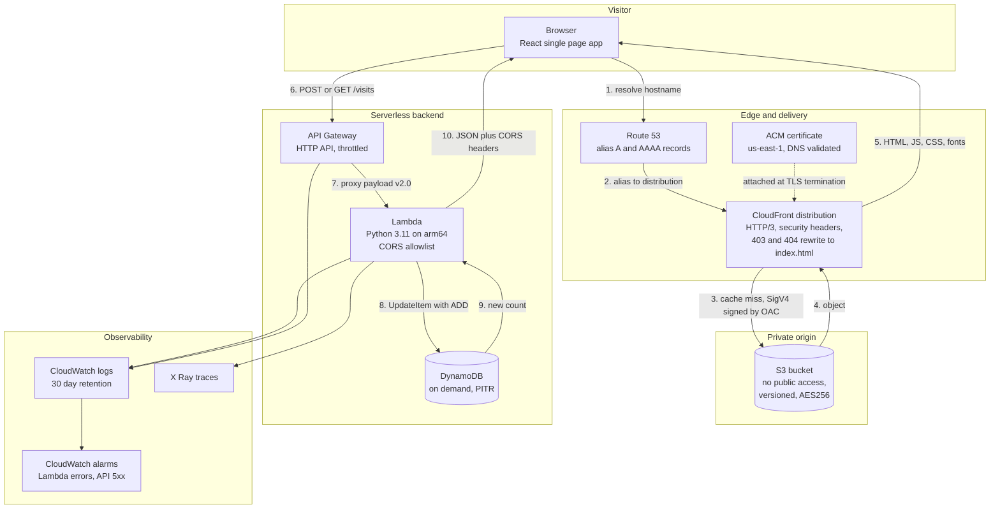
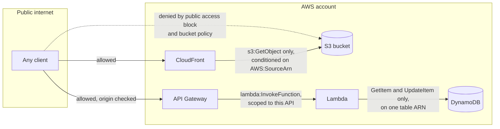
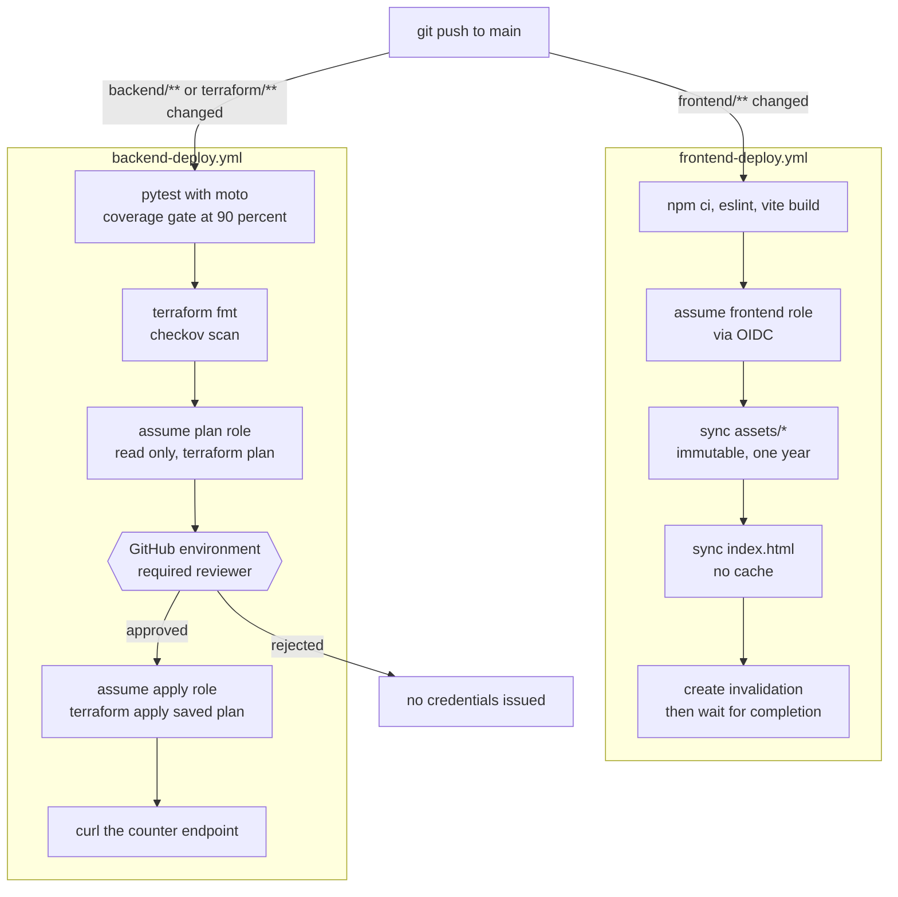

# Architecture

## Runtime request path

Two independent paths from the browser. The page itself is a cached static asset. The visit counter is a separate API call that never touches CloudFront.

### Why the two paths never meet

The counter is not routed through CloudFront. Putting an API behind the same distribution means either a second cache behavior with caching disabled, or a counter that returns a stale number from the edge. Keeping them separate costs one extra DNS lookup on first paint and removes a whole class of caching bug.

The tradeoff is CORS. That is why the Lambda owns the allowlist and refuses an unrecognized origin with a 403 rather than silently omitting a header.

## Trust boundaries

Every arrow inside the account is a named action on a named resource. There is no wildcard resource in the Lambda execution role, and the bucket policy grants read to the CloudFront service principal only when the request carries this distribution's ARN.

## Delivery pipeline

The plan job and the apply job assume different roles. The plan role carries `ReadOnlyAccess`, so a plan running on a pull request cannot change infrastructure even if the workflow file in that pull request is modified. The apply role is trusted only for the `production` environment claim, which means the credentials that can write do not exist until a human has approved the run.

## Resource inventory

| Layer | Resource | Notable configuration |
| --- | --- | --- |
| DNS | Route 53 alias records | Created only when `enable_custom_domain` is true |
| TLS | ACM certificate | us-east-1, DNS validated, waits for issuance |
| CDN | CloudFront distribution | OAC origin, HTTP/3, HSTS, CSP, SPA error rewrite |
| Origin | S3 bucket | Public access blocked, versioned, lifecycle expiry |
| API | API Gateway HTTP API | No CORS block, access logs, 25 request per second cap |
| Compute | Lambda | Python 3.11, arm64, 256 MB, 5 second timeout, X Ray |
| Data | DynamoDB table | On demand, PITR, deletion protection, encrypted |
| Identity | 3 IAM roles for GitHub | OIDC federated, subject pinned, no access keys |
| State | S3 bucket plus DynamoDB table | Versioned state, lock table, both protected from destroy |
| Alarms | 2 CloudWatch alarms | Lambda errors and API 5xx |
